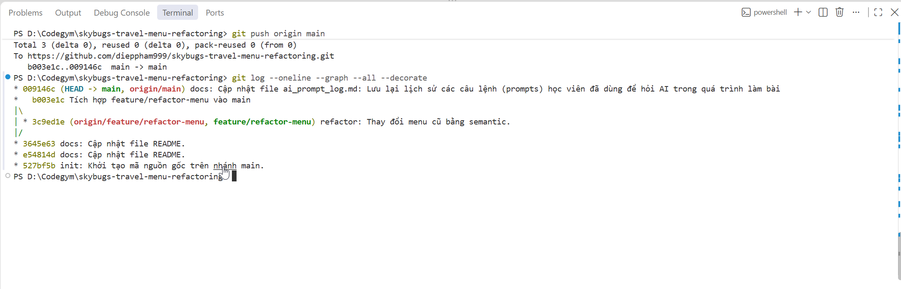

# SkyBugs Travel - Menu Refactoring

## 1. Giới thiệu

Bài tập nâng cấp menu điều hướng của hệ thống đặt vé máy bay **SkyBugs Travel**, chuyển đổi cấu trúc HTML cũ sang danh sách có ngữ nghĩa và thực hành quy trình Git Branching & Merging.

## 2. Mục tiêu

- Sử dụng đúng cấu trúc HTML: `nav > ul > li > a`.
- Cải thiện khả năng truy cập (Accessibility) và hỗ trợ SEO.
- Phát triển tính năng trên nhánh Git độc lập, không chỉnh sửa trực tiếp trên `main`.
- Hợp nhất và kiểm tra lịch sử Git sau khi hoàn thành.

## 3. Yêu cầu triển khai

### HTML

- Thay menu cũ bằng danh sách `<ul id="main-menu">`.
- Tạo bốn mục điều hướng: Trang chủ, Chuyến bay, Khách sạn, Khuyến mãi.
- Mỗi mục sử dụng `<li>` chứa một liên kết `<a>`.
- Giữ nguyên nội dung chính của trang.

### Git Workflow

1. Khởi tạo Git và commit mã nguồn gốc trên nhánh `main`.
2. Tạo nhánh `feature/refactor-menu` từ `main`.
3. Tự cập nhật HTML, kiểm thử và commit trên nhánh tính năng.
4. Quay lại `main` và merge nhánh tính năng.
5. Kiểm tra lịch sử bằng lệnh:

```bash
git log --oneline --graph --all --decorate
```

> Có thể dùng `git merge --no-ff feature/refactor-menu` để giữ merge commit rõ ràng trong lịch sử; đề bài không bắt buộc tùy chọn này.

## 4. Cấu trúc dự án

```text
skybugs-travel-menu-refactoring/
├── index.html
├── README.md
├── ai_prompt_log.md
└── git-graph.png
```

## 5. Bằng chứng Git Workflow

Sau khi hoàn thành, chụp kết quả lệnh `git log --oneline --graph --all` và lưu thành `git-graph.png` tại thư mục gốc.



> Lưu ý: Ảnh chỉ hiển thị khi file `git-graph.png` đã được thêm vào repository.

## 6. Kiến thức cần bảo vệ

- Vì sao cần commit base code trên `main` trước khi tạo nhánh feature?
- `<ul>` và `<ol>` khác nhau thế nào? Khi nào menu có thể dùng `<ol>`?
- `git checkout main` ảnh hưởng ra sao đến các file trong thư mục làm việc?
- Fast-forward merge khác merge commit thế nào?

## 7. Sản phẩm bàn giao

- `index.html`: HTML hoàn chỉnh sau khi merge vào `main`.
- `git-graph.png`: Ảnh chụp lịch sử phân nhánh và hợp nhất Git.
- `ai_prompt_log.md`: Nhật ký câu hỏi thực tế đã trao đổi với AI.
- `README.md`: Tài liệu mô tả bài tập.

## 8. Công nghệ

HTML5 · Git · GitHub


